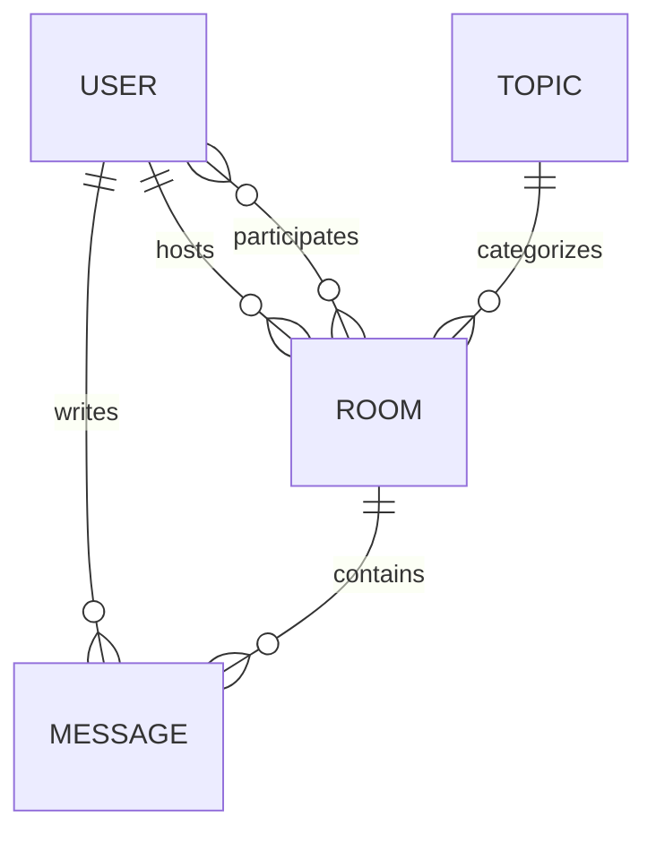

# StudyBuddy 2.0 Data Model

**Status:** Current model documented; future changes proposed  
**Last updated:** 2026-10-25

> **Document conventions**
> **Existing** means the field or behavior is present in `backend/base/models.py` today.  
> **Proposed** means a future change that has not been created or applied.
>
> No migrations are created or applied by this document.

Related documents: [Product requirements](../product/requirements.md) · [Architecture overview](overview.md) · [Roadmap](../development/roadmap.md)

## 1. Current entities (existing)

### Topic

| Field | Type | Rules and behavior |
|---|---|---|
| `id` | BigAutoField | Primary key |
| `name` | CharField(200) | Required at the model level; not unique |

`Topic` has no timestamps and no owner. A topic can be created implicitly while creating a room. Deleting a topic sets `Room.topic` to `NULL`.

### Room

| Field | Type | Rules and behavior |
|---|---|---|
| `id` | BigAutoField | Primary key |
| `host` | ForeignKey(User) | `null=True`, `on_delete=SET_NULL`; reverse accessor is `user.room_set` |
| `topic` | ForeignKey(Topic) | `null=True`, `on_delete=SET_NULL`; reverse accessor is `topic.room_set` |
| `name` | CharField(200) | Required at the model level; not unique |
| `description` | TextField | `null=True`, `blank=True` |
| `participants` | ManyToManyField(User) | `blank=True`, `related_name='participants'`; reverse accessor on a user is `user.participants`, which returns rooms rather than users |
| `updated` | DateTimeField | `auto_now=True`; changes whenever the room is saved |
| `created` | DateTimeField | `auto_now_add=True` |
| `Meta.ordering` | — | `['-updated', '-created']` |

### Message

| Field | Type | Rules and behavior |
|---|---|---|
| `id` | BigAutoField | Primary key |
| `user` | ForeignKey(User) | `on_delete=CASCADE`; reverse accessor is `user.message_set` |
| `room` | ForeignKey(Room) | `on_delete=CASCADE`; reverse accessor is `room.message_set` |
| `body` | TextField | Required at the database level; no maximum length |
| `updated` | DateTimeField | `auto_now=True` |
| `created` | DateTimeField | `auto_now_add=True` |
| `Meta.ordering` | — | `['-updated', '-created']` |

The current room view displays room messages with an explicit `order_by('-created')`. The activity page uses the model's default ordering.

## 2. Current relationships

| Relationship | Cardinality | Notes |
|---|---|---|
| `User` → hosted `Room` | One-to-many | A user may host many rooms |
| `User` ↔ participating `Room` | Many-to-many | Implicit participation; a user is added when they post |
| `Topic` → `Room` | One-to-many | A room may have one topic; a topic may have many rooms |
| `User` → `Message` | One-to-many | A user may write many messages |
| `Room` → `Message` | One-to-many | A room may contain many messages |

## 3. Current ownership, membership, and visibility

### Ownership

- `Room.host` is the room owner.
- `Message.user` is the message author.
- Only the room host can edit or delete the room in the application.
- Only the message author can delete the message in the application.
- Staff can manage records through Django admin.
- A room with `host=None` has no in-application owner. This can happen after the host account is deleted because `Room.host` uses `SET_NULL`.

### Membership

- `Room.participants` is the only membership representation.
- It is populated when an authenticated user posts a message.
- It is not used for authorization.
- There is no join date, role, invitation, approval, or leave action.
- The reverse accessor name `User.participants` is easy to confuse with `Room.participants`; API serializers should make the direction explicit.

### Visibility

- All rooms and messages are public.
- Guests can read rooms, messages, profiles, topics, and activity.
- Guests cannot post messages or create rooms.
- There is no private, unlisted, or invite-only room behavior.

## 4. Current authorization rules (verified)

| Action | Required condition |
|---|---|
| View rooms, messages, profiles, topics, activity | No authentication required |
| Create a room | Authenticated |
| Post a message | Authenticated |
| Edit or delete a room | Authenticated and `request.user == room.host` |
| Delete a message | Authenticated and `request.user == message.user` |
| Edit profile | Authenticated; only the current user's username and email |

The application returns `403 Forbidden` for ownership violations and `404 Not Found` for missing objects.

## 5. Current deletion behavior

| Deletion | Effect |
|---|---|
| Delete a room | Its messages are deleted by `CASCADE` |
| Delete a user | Their messages are deleted by `CASCADE`; hosted rooms remain with `host=NULL`; participant links are removed |
| Delete a topic | Rooms remain with `topic=NULL` |
| Delete a message | Only that message is removed |

These behaviors are important for future account-deletion and moderation decisions. They should not be changed casually.

## 6. Existing integrity gaps and technical debt

These are observations about the current schema, not proposed implementations.

- `Topic.name` is not unique, so duplicate topic names are possible, including differences in capitalization.
- `Room.name` is not unique; duplicate room names are allowed.
- `Message.body` has no maximum length and is not validated as non-empty in the current view.
- `Message.Meta.ordering` is present in the model but absent from migrations `0001`–`0006`. `makemigrations --check` proposes `0007_alter_message_options`.
- The current `Message` migration drift is state-only and does not change the database schema, but it should be resolved before new schema work.
- There are no indexes tuned for feed or room-message queries beyond the indexes Django creates for foreign keys.
- Users have no separate profile record; username and email live on Django's built-in `User`.
- There is no audit trail for room or message changes.

## 7. Proposed MVP model position

The MVP does **not** require a new domain model. It should preserve the existing entities and relationships.

Proposed MVP-level work:

1. Resolve the `Message.Meta.ordering` migration drift with a small reviewed migration.
2. Add serializer-level validation for non-empty messages and sensible length limits.
3. Normalize topic names when creating rooms; avoid duplicate topics through application logic.
4. Keep public-room visibility unchanged.
5. Add indexes only if measured query performance requires them.

Deliberately deferred for the MVP:

- A separate `UserProfile` model.
- A `RoomMembership` model.
- A `Room.visibility` field.
- Invitations, notifications, attachments, reactions, and moderation records.

This keeps the MVP focused on shipping the existing product through the new API and UI.

## 8. Proposed post-MVP entities

These entities are **not implemented** and should only be added when a validated product requirement exists.

### UserProfile (proposed)

| Field | Purpose |
|---|---|
| `user` | One-to-one relationship with Django `User` |
| `display_name` | Optional public display name |
| `bio` | Optional short biography |
| `avatar` | Optional profile image reference |
| `timezone` | Optional user preference |

Useful if profile customisation becomes important. Until then, Django `User` fields are sufficient.

### RoomMembership (proposed)

| Field | Purpose |
|---|---|
| `room` | Foreign key to `Room` |
| `user` | Foreign key to `User` |
| `role` | Host, moderator, or member |
| `status` | Active, pending, invited, or blocked |
| `joined_at` | Membership timestamp |

A unique constraint on `(room, user)` would prevent duplicate memberships. This model becomes necessary if explicit joining, private rooms, roles, or invitations are introduced.

### Room visibility (proposed)

Add a `visibility` field to `Room` with values such as `public`, `unlisted`, and `private`.

Proposed rules:

- **Public:** discoverable and readable by anyone.
- **Unlisted:** readable by direct link but excluded from listings and search.
- **Private:** readable only by active members and staff.
- **Host and moderators:** manage room settings, membership, and content.
- **Invitations:** required for private rooms unless the host adds a member directly.

These rules are not part of the MVP.

### Invitation (proposed)

| Field | Purpose |
|---|---|
| `room` | Target room |
| `invited_by` | Member or host issuing the invitation |
| `invitee` | Optional existing user |
| `email` | Optional invitee email |
| `token` | Unique invitation token |
| `status` | Pending, accepted, declined, expired |
| `expires_at` | Expiration timestamp |

### Other post-MVP entities

| Entity | Purpose | Trigger |
|---|---|---|
| `Notification` | Notify users about replies, invitations, or moderation | When notification requirements are validated |
| `MessageAttachment` | Attach files or images to messages | When storage and moderation policies exist |
| `MessageReaction` | Lightweight reactions | When engagement requirements justify it |
| `AuditEvent` | Record moderation and ownership changes | When moderation workflows are introduced |

## 9. Proposed membership migration path

If explicit memberships are introduced later:

1. Create `RoomMembership` without removing `Room.participants`.
2. Backfill one membership per existing participant with role `member`.
3. Create a host membership for each room with a non-null host.
4. Run the old and new representations in parallel for one release.
5. Update authorization to use memberships.
6. Remove `Room.participants` only after data verification and a rollback plan.

This must be a reviewed data migration, tested against a copy of production-like data. It is not part of Phase 1.0 or the MVP.

## 10. Proposed visibility and permission matrix (post-MVP)

| Action | Public room | Unlisted room | Private room |
|---|---|---|---|
| Discover in listings/search | Yes | No | No |
| Read by direct link | Yes | Yes | Members and staff only |
| Post as authenticated non-member | Yes | Yes, if intended | No |
| Edit room | Host | Host | Host or moderator |
| Delete room | Host | Host | Host |
| Manage membership | Not applicable | Host | Host or moderator |

The MVP keeps the first column only: all rooms are public and all writes require authentication.

## 11. Rules for future schema changes

- Do not edit migrations `0001`–`0006`.
- Resolve the known `Message` ordering drift before adding new model fields.
- Back up the SQLite database before applying migrations or transferring data.
- Keep schema changes and data migrations in separate, reviewable steps when practical.
- Preserve current deletion semantics unless a product decision explicitly changes them.
- Add tests for every new ownership or visibility rule.
- Do not expose email addresses or password data through API serializers.
