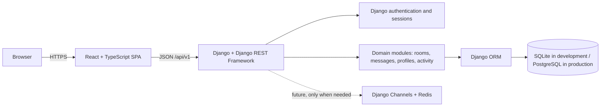

# StudyBuddy 2.0 Architecture Overview

**Status:** Proposed for Phase 1.0  
**Last updated:** 2026-10-25

> **Document conventions**
> **Verified** means the behavior or technology exists in the repository today.  
> **Proposed** means planned work that has not been implemented or installed.

Related documents: [Product requirements](../product/requirements.md) · [Data model](data-model.md) · [Roadmap](../development/roadmap.md)

## 1. Purpose

This document describes how StudyBuddy can evolve from a server-rendered Django application into a maintainable React and Django API product without discarding the working domain logic, tests, or data.

The proposed architecture is a **modular monolith**:

- One Django backend deployment.
- One React single-page application.
- Clear internal modules with explicit responsibilities.
- No microservices, message brokers, or distributed infrastructure in the MVP.

## 2. Current state (verified)

| Area | Current implementation |
|---|---|
| Backend | Django 4.2, Python 3.10, function-based views |
| Application layout | One Django app, `backend/base/` |
| Frontend | Django templates, server-rendered HTML, static CSS and JavaScript |
| API | None; views return HTML or redirects |
| Authentication | Django session authentication and built-in user model |
| Database | SQLite at `backend/db.sqlite3` |
| Authorization | Host-only room changes and author-only message deletion |
| Tests | 36 Django tests in `backend/base/tests.py`; system checks and tests pass |
| Dependencies | Django and its direct dependencies only; DRF, React, Channels, Redis, and PostgreSQL are not installed |

The current application is a working behavioral reference. It is not necessary to rewrite its domain rules from scratch.

## 3. Target architecture (proposed)



### Component responsibilities

| Component | Responsibility |
|---|---|
| React SPA | Routing, screens, forms, client-side validation, authentication state, API calls, loading and error states |
| Django API | Request validation, serialization, permissions, business rules, pagination, HTTP semantics |
| Django authentication | Users, password hashing, sessions, CSRF, staff access |
| Domain modules | Room ownership, message authorship, topic association, profile and activity queries |
| Django ORM | Database access and migrations |
| Database | Durable application data |
| Future Channels layer | Real-time updates only if HTTP refresh/polling is no longer sufficient |

### Why a modular monolith

The product has a small domain, one team, and no independent scaling requirement for separate services. A modular monolith keeps deployment, debugging, transactions, and testing simple. Internal boundaries can still be clear without paying the operational cost of separate services.

Do not split the backend into microservices for the MVP.

## 4. Proposed repository structure

The current backend remains in place. The API is added as a package inside the existing domain app for the MVP. This avoids moving models and rewriting migration history prematurely.

```text
backend/
  config/                 # Django settings, root URLs, WSGI/ASGI
  base/
    models.py             # Existing Topic, Room, Message
    admin.py
    api/
      serializers.py      # API input and output shapes
      views.py            # API endpoints
      permissions.py      # Object-level authorization rules
      urls.py             # /api/v1/ routes
    tests/
      test_api_auth.py
      test_api_rooms.py
      test_api_messages.py
      test_api_permissions.py
  requirements/
frontend/
  src/
    app/                  # App shell, router, providers
    features/
      auth/
      rooms/
      messages/
      profiles/
      activity/
    components/           # Shared presentational components
    lib/
      api/                # Typed fetch client and error handling
      auth/               # Session/CSRF helpers
    styles/
  tests/
docs/
```

### Module boundaries

- `auth`: registration, login, logout, current-user state.
- `rooms`: topic discovery, room listing, room detail, room ownership.
- `messages`: posting, listing, deleting messages, participant updates.
- `profiles`: public profile data and self-service editing.
- `activity`: recent message feed.

For the MVP, these are logical modules inside `base/`. Split them into separate Django apps only if the codebase or team grows enough to justify model moves and migration coordination.

## 5. Frontend and backend communication

### API style

- REST over HTTPS with JSON request and response bodies.
- Versioned base path: `/api/v1/`.
- Django REST Framework serializers for validation and representation.
- Trailing slashes on API routes for consistency.
- ISO 8601 timestamps in UTC.
- Integer primary keys for the MVP.

### Proposed endpoints

| Method | Endpoint | Purpose |
|---|---|---|
| `GET` | `/api/v1/auth/csrf/` | Ensure the CSRF cookie is available |
| `POST` | `/api/v1/auth/register/` | Create an account and session |
| `POST` | `/api/v1/auth/login/` | Authenticate and create a session |
| `POST` | `/api/v1/auth/logout/` | End the session |
| `GET` | `/api/v1/auth/me/` | Return the current user |
| `GET` | `/api/v1/topics/` | List topics and room counts |
| `GET` | `/api/v1/rooms/` | List, search, filter, and paginate rooms |
| `POST` | `/api/v1/rooms/` | Create a room |
| `GET` | `/api/v1/rooms/<id>/` | Room detail |
| `PATCH` | `/api/v1/rooms/<id>/` | Update a room as its host |
| `DELETE` | `/api/v1/rooms/<id>/` | Delete a room as its host |
| `GET` | `/api/v1/rooms/<id>/messages/` | List room messages |
| `POST` | `/api/v1/rooms/<id>/messages/` | Post a message |
| `DELETE` | `/api/v1/messages/<id>/` | Delete a message as its author |
| `GET` | `/api/v1/profiles/<id>/` | Public profile |
| `PATCH` | `/api/v1/profiles/me/` | Update the current user's profile |
| `GET` | `/api/v1/activity/` | Recent message activity |

The exact endpoint names may be adjusted during API design, but the resource boundaries and permission rules should remain stable.

### Response conventions

- Use DRF's standard pagination shape: `count`, `next`, `previous`, `results`.
- Use standard status codes: `200`, `201`, `204`, `400`, `401`, `403`, `404`.
- Use DRF validation errors for field-level problems.
- Avoid a custom response envelope unless a concrete need appears.
- Return only public user fields; never return passwords, password hashes, or email addresses in public payloads.

### Development and production origins

The preferred deployment is **same-origin**: the React build and the Django API are served from the same site, with `/api` routed to Django and other paths serving the SPA.

- During development, Vite proxies `/api` to Django so the browser still sees one origin.
- If separate origins become necessary, configure CORS with credentials and `CSRF_TRUSTED_ORIGINS`. This is a deliberate deployment decision, not a default.
- Do not use wildcard CORS with credentialed requests.

## 6. Authentication and authorization

### Chosen approach: Django sessions plus CSRF

Use Django's existing session authentication for the MVP.

- Login creates a session cookie.
- The React client sends `credentials: 'include'`.
- Unsafe requests include the CSRF token in the `X-CSRFToken` header.
- Logout uses `POST` and is CSRF-protected.
- The API exposes the current user through `/api/v1/auth/me/`.

This approach reuses Django's mature authentication, works with the existing user model, avoids storing bearer tokens in browser storage, and keeps session revocation straightforward.

### Alternatives not chosen for the MVP

- **JWT access and refresh tokens:** adds token storage, refresh rotation, revocation, and clock-skew concerns without a current requirement.
- **DRF token authentication in `localStorage`:** convenient but exposes long-lived credentials to XSS and complicates revocation.
- **Third-party identity provider:** useful later, but not part of the MVP.

Revisit token or OAuth authentication only when a native mobile client, third-party client, or separate-domain deployment requires it.

### Authorization model

Permissions are enforced by the API, not by hidden UI controls.

| Rule | Enforcement |
|---|---|
| Guests may read public content | Allow-any read permission on public resources |
| Only signed-in users may write | `IsAuthenticated` on create, update, and delete operations |
| Only a room host may edit or delete the room | Object-level permission and/or service check |
| Only a message author may delete the message | Object-level permission |
| Staff may manage data through Django admin | Django admin permissions |

Custom permission classes should be small and tested directly. When an object is missing, return `404`; when it exists but the user lacks permission, return `403`.

## 7. Database strategy

### Development: keep SQLite

SQLite is sufficient for local development, tests, and a small internal beta. It requires no separate service and keeps setup simple.

Constraints to respect:

- Avoid SQLite-specific SQL.
- Keep writes short and transactional.
- Do not assume high write concurrency.
- Do not run multiple production application workers against a shared SQLite file.

### Production: PostgreSQL

Move to PostgreSQL before public launch. The Django ORM and migrations should make this a configuration and operations change rather than a domain rewrite.

- No PostgreSQL-specific features are required for the MVP.
- Search can use `icontains` initially; consider PostgreSQL full-text or trigram indexes only if measured performance requires it.
- Use environment-driven database configuration when the switch is implemented.
- Back up the SQLite database before any migration or data transfer.

### Migration discipline

- Every schema change is captured in a reviewed migration.
- Existing migrations are not edited.
- The known `Message.Meta.ordering` migration drift is resolved before new schema work.
- Data migrations are tested against a copy of realistic data.
- No database file is committed to version control.

## 8. Deployment considerations

The MVP can be developed locally with SQLite. A public deployment needs the following:

- Django served through a production WSGI server such as Gunicorn.
- A reverse proxy such as Nginx or Caddy for TLS, static files, and request limits.
- PostgreSQL managed by the hosting environment.
- React build artifacts served as static files, with SPA fallback to `index.html` for client-side routes.
- `/api`, `/admin`, and `/static` routed to Django rather than the SPA fallback.
- Environment variables for `SECRET_KEY`, `DEBUG=False`, `ALLOWED_HOSTS`, database credentials, and allowed origins.
- HTTPS, secure session and CSRF cookies, and HSTS.
- Logging, error tracking, health checks, backups, and a restore procedure.
- A database migration step in deployment.

Django Channels would require an ASGI deployment and Redis. That is intentionally deferred.

## 9. Trade-offs and alternatives

| Decision | Chosen approach | Alternative | Why |
|---|---|---|---|
| System shape | Modular monolith | Microservices | One small domain and team; simpler transactions, deployment, and debugging |
| UI | React SPA | Continued Django templates | Richer interaction and a cleaner long-term frontend, at the cost of a second build and API layer |
| API framework | Django REST Framework | Hand-written JSON views | Serializers, permissions, pagination, and testing support reduce boilerplate |
| Authentication | Session + CSRF | JWT or token auth | Simpler and more secure for a same-origin browser app |
| Development database | SQLite | PostgreSQL immediately | Lower setup friction; switch before production |
| Production database | PostgreSQL | SQLite | Concurrency, operational tooling, and managed backups |
| Backend structure | One app with internal modules | Split domain apps now | Avoids risky model moves and migration history changes before the API stabilizes |
| Real-time | HTTP refresh/polling first | Channels + Redis immediately | Most MVP usage does not require live push; adds significant infrastructure |
| Frontend tooling | Vite + React + TypeScript | Next.js or another framework | No SSR or SEO requirement for an authenticated application; simpler deployment |
| API versioning | `/api/v1/` | Unversioned API | Allows future breaking changes without stranding clients |
| Styling | Reuse and evolve existing CSS | Full design-system rewrite | Preserves current visual work and reduces MVP scope |

### Rejected for now

- GraphQL: no current client need for flexible queries.
- Microservices or separate auth service: unjustified operational cost.
- Event bus, Celery, or background workers: no asynchronous workload yet.
- Server-side rendering: no confirmed SEO or first-paint requirement.
- Separate frontend domain: adds CORS and cookie complexity.

## 10. Risks and mitigations

| Risk | Mitigation |
|---|---|
| Two UIs drift during migration | Treat the current templates as the behavioral reference, maintain a parity checklist, and freeze non-critical template changes |
| Session/CSRF misconfiguration in the SPA | Use same-origin development proxy and integration tests for login, CSRF failure, and logout |
| Migration drift blocks schema work | Resolve the existing `Message` ordering drift as a small reviewed migration before Phase 1.2 |
| Premature app splitting causes migration churn | Keep `base` and logical API modules until a concrete boundary problem appears |
| SQLite concurrency limits | Use PostgreSQL before public launch and avoid shared-file production deployments |
| Scope creep into private rooms or real-time chat | Enforce MVP exclusions and use explicit decision gates in the roadmap |
| Missing CI allows regressions | Add automated test execution before the React write features are considered complete |
| Secrets or insecure defaults reach production | Keep environment-based settings, perform a deployment checklist, and rotate any exposed development key |

## 11. Implementation guardrails

- Do not install DRF, React, Channels, Redis, or PostgreSQL as part of Phase 1.0.
- Do not move models or create migrations while documenting architecture.
- Do not build private rooms, real-time messaging, notifications, or moderation dashboards before the MVP is validated.
- Do not add a service layer or abstraction until multiple callers need it.
- Keep the API and UI permission models aligned through shared, tested rules.
- Preserve existing data and the working server-rendered application until the React replacement reaches parity.
